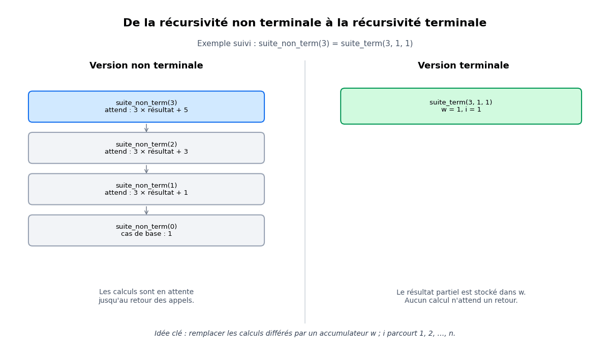

# Correction du TD 4 — La récursivité


------------------------------------------------------------------------

## Exercice 1 : Récursivité croisée ou mutuelle


```c
#include <stdio.h>
int u(int n);
int v(int n);

int u(int n) {
	if (n == 0)
		return 3;
	else
		return 2 * v(n - 1) + 1;
}

int u_ternaire (int n) {
	return (n == 0) ? 3 : 2 * v(n - 1) + 1;
}

int v(int n) {
	if (n == 0)
		return 1;
	else {
		if (n == 1)
			return 2 * u (0) + 3;
		else
			return u(n - 1) + 3 * v(n - 2);
	}
}

void main () {
	int N;
	do {
		printf (" Donner N (0 <= N <= 25) : ");
		scanf ("%d", &N);
	} while (N < 0 || N > 25);

	printf ("u(%d) = %d\n", N, u(N));
	printf ("v(%d) = %d\n", N, v(N));
}

```


------------------------------------------------------------------------

## Exercice 2 : Suite récurrente arithmético-géométrique


```c
#include <stdio.h>
unsigned suite_non_term (unsigned n) {
	if (n == 0)
		return 1;
	else
		return 3*suite_non_term(n-1) + 2*n - 1;
}

unsigned suite_non_term_ternaire (unsigned n) {
	return (n == 0) ? 1 :
	    3*suite_non_term_ternaire (n-1) + 2*n - 1;
}
unsigned suite_term (unsigned n, unsigned w, unsigned i) {
	if (n == 0)
		return w;
	else
		return suite_term (n-1, 3*w + 2*i - 1, i+1);
}

unsigned suite_term_ternaire(unsigned n, unsigned w, 	unsigned i) {
	return (n == 0) ? w : suite_term_ternaire (n-1,
					3*w + 2*i - 1, i+1);
}
void main () {
	unsigned n;
	printf (" Donner n (0 <= n <= 25) : ");
	scanf ("%u", &n);

	printf("Recursif non terminal : W_%u = %u\n", n, suite_non_term (n));
	printf("Recursif terminal : W_%u = %u\n", n, suite_term (n, 1,1));
}
```


### Version non terminale

- Pour `suite_non_term(3)`, les appels descendent jusqu’à `suite_non_term(0)`. 
- Ensuite, les calculs s’effectuent au retour : `S(0)=1`, `S(1)=4`, `S(2)=15`, `S(3)=50` 


### Version terminale

- L’appel initial est : `suite_term(3, 1, 1);`


| Appel   | n | w  | i |
|---------|---|----|---|
| Initial | 3 | 1  | 1 |
| Etape 1 | 2 | 4  | 2 |
| Etape 2 | 1 | 15 | 3 |
| Etape 3 | 0 | 50 | 4 |


Lorsque `n == 0`, la procédure renvoie directement `w`, soit `50`.


La transformation consiste à remplacer les calculs différés par une mise à jour de l’accumulateur `w`. Ainsi, l’appel récursif devient la dernière opération de la procédure: **c’est la récursivité terminale**.




------------------------------------------------------------------------

## Exercice 3 : 


```c


```

------------------------------------------------------------------------


## Exercice 3 : 


```c


```

------------------------------------------------------------------------


## Exercice 3 : 


```c


```

------------------------------------------------------------------------


## Exercice 3 : 


```c


```

------------------------------------------------------------------------
